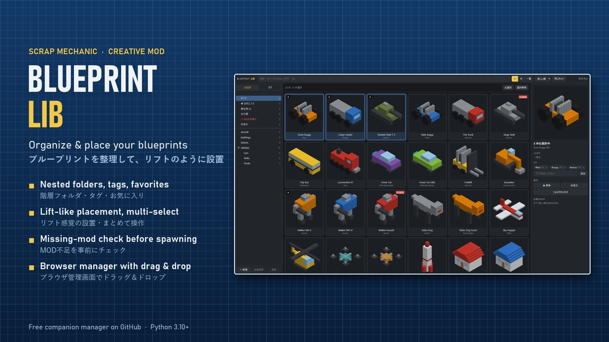

# Blueprint Lib

English ・ **[日本語](README.md)**

A **lift replacement for Scrap Mechanic (Creative)** that organizes your blueprints.
Sort hundreds of blueprints into folders, tags and favorites, then place them just like with the lift —
either from the in-game menu or from a browser-based manager, without starting the game.

Your `Blueprints` folder is **only read**. The organization is stored in the mod's own `library.json`;
your blueprint files are never modified.



## Features

- **Nested folders, tags, favorites, hidden, recently used**
- Three views (large icons / icons / list), search (with `#tag`), sorting
- Multi-select: move, tag, hide or **place one after another** in bulk
- Lift-like placement: ghost preview, Q rotate, F height, R physics / fixed
- **Missing-mod detection**: blueprints that use parts from mods not enabled in the current world get a ⚠
  and can't be placed (no more half-spawned creations)
- **Browser manager**: real drag & drop, Ctrl/Shift range selection, required mods with Steam links,
  "Place in game" button
- Edit in the game and in the manager at the same time — both sides' changes are kept
- **4 languages**: English, Japanese, Korean, Simplified Chinese. In game it follows the game's language; the manager follows your browser (or pick one at the top right)

## Requirements

- Scrap Mechanic — **Creative only** (the tool refuses to work in Survival)
- **Python 3.10+** for the manager / blueprint list ([python.org](https://www.python.org/downloads/),
  tick "Add python.exe to PATH"). Lua mods can't list folders, so the blueprint list has to be built outside the game.

## Installation

The manager ships inside the mod: subscribing gets you everything, and Steam updates both together.

1. Subscribe to **Blueprint Lib** on the Steam Workshop and start the game once (so it downloads)
2. Open the mod's folder:
   `<Steam library>\steamapps\workshop\content\387990\<item id>\`
   - the item id is the number after `?id=` in the Workshop page URL
   - to find your Steam library: right-click Scrap Mechanic in Steam → Manage → Browse local files opens
     `steamapps\common\Scrap Mechanic`; go up two levels to `steamapps`, then into `workshop\content\387990`
3. Double-click **`Blueprint Lib Manager.bat`** in that folder. The manager opens in your browser — press **Rescan**
   - if you use it often, make a shortcut to that `.bat` on your desktop
4. Create (or edit) a Creative world and enable the mod "Blueprint Lib"
5. Take the tool from the inventory and **right-click** to open the library

Without the Workshop: extract `BlueprintLib-<version>.zip` from [Releases](../../releases) and copy its
`Blueprint Lib` folder into `%APPDATA%\Axolot Games\Scrap Mechanic\User\User_<SteamID>\Mods\`.
The manager is started from the `Blueprint Lib Manager.bat` inside that folder.

After saving new blueprints or changing your mods, press **Rescan** in the manager and **Reload** in the in-game menu.

## Controls (tool held)

| Input | Action |
|---|---|
| RMB / R | open the library |
| LMB | place (while placing) |
| Q | rotate |
| F | spawn height (0.5 → 1 → 2 → 4 → 8 → 0.25 m) |
| R | physics / fixed (while placing) |
| RMB | cancel placing |

Manager shortcuts: `/` search, `F2` rename folder, `Enter` / double-click = place in game,
Ctrl+A / Esc select all / none.

Folder input: `Name` and `A/B` are relative to the selected folder (create) or to the folder's current
place (rename); `/A/B` is absolute.

## Data

| File | Contents |
|---|---|
| `<mod>/Data/index.json` | blueprint list (manager → Rescan) |
| `<mod>/Data/library.json` | folders, tags, … (saved by the game and the manager) |
| `%APPDATA%\BlueprintLib\library.json` | backup with a 20-version history |

If a Workshop update replaces the mod folder, the manager restores `library.json` from the backup automatically.

## Limitations

- Placing works in single player / as host (the blueprint file must exist on the host's PC)
- No collision check when placing
- Part sizes are approximated when centering, so a creation may be off by a block or two
- The in-game menu can't do real drag & drop (the game's GUI API has no drag events); it uses two clicks instead

## Development

See the Japanese README for the file layout. Release helpers:

```bat
python tools\release.py prepare-upload   & rem stash personal data, check the upload
python tools\release.py restore          & rem bring it back
python tools\release.py zip              & rem dist/BlueprintLib-<VERSION>.zip for GitHub
```

The in-game menu layout is generated by `tools/gen_layout.py` — edit that, not the `.layout` file.

## License

[MIT](LICENSE) — you are free to modify, redistribute and use it commercially; just keep the copyright
notice and the license text (`LICENSE`).
