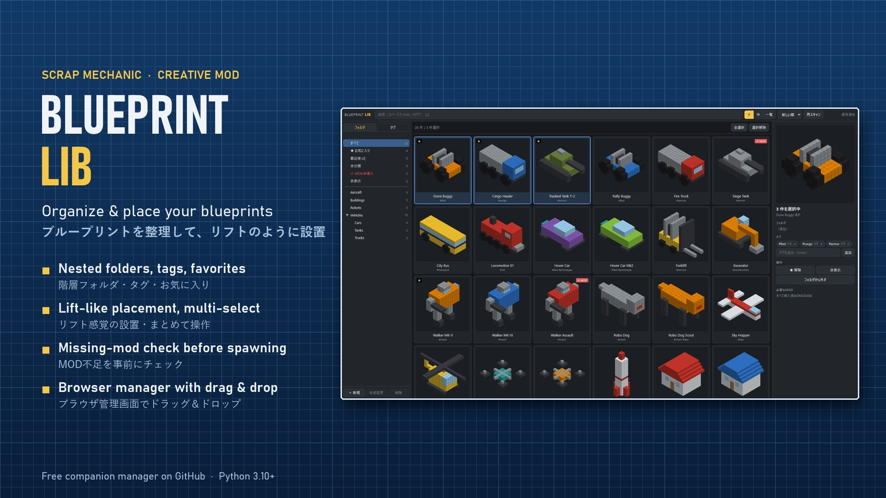

# Blueprint Lib

**[English](README.en.md)** ・ 日本語

Scrap Mechanic のクリエイティブ向け、**リフトの代わりになるブループリント管理ツール**です。
何百個もあるブループリントを、フォルダ・タグ・お気に入りで整理して、リフトのように設置できます。
整理はゲーム内のメニューでも、ゲームを起動せずにブラウザの管理画面（マネージャー）でもできます。

元の `Blueprints` フォルダは**読み取るだけ**です。整理した情報は MOD 側の `library.json` に保存するので、ブループリント自体には一切手を加えません。



## 特徴

- **フォルダ（階層あり）・タグ・お気に入り・非表示・最近使った**で整理
- 3種類の表示（大きいアイコン / アイコン / 一覧）、検索（`#タグ` 検索あり）、並び替え
- 複数選択して、まとめてフォルダへ移動・タグ付け・非表示・**順に設置**
- 設置はリフトと同じ感覚で行えます。ゴースト表示・Q で回転・F で高さ・R で「物理あり / 固定」
- **MOD不足の判定**：今のワールドで有効になっていない MOD のパーツを使うブループリントには ⚠ が付き、設置ボタンが無効になります
- **ブラウザ版マネージャー**：本物のドラッグ＆ドロップ、Ctrl / Shift での範囲選択、必要な MOD と Steam のページへのリンク、「ゲームで設置」ボタン
- ゲームとマネージャーで同時に編集しても、どちらの変更も残ります
- **4言語対応**：英語・日本語・韓国語・中国語（簡体字）。ゲーム内はゲームの言語設定に、マネージャーはブラウザの言語に合わせて切り替わります（マネージャーは右上の欄でも変更できます）

## 必要なもの

- Scrap Mechanic（**クリエイティブモード**専用です。サバイバルでは動作しません）
- マネージャーとブループリント一覧の作成に **Python 3.10 以上**（[python.org](https://www.python.org/downloads/) からインストールし、「Add python.exe to PATH」にチェック）
  - ゲーム内の Lua からはフォルダの中身を一覧できないため、一覧の作成だけは外部で行う必要があります

## 導入

マネージャーは MOD に同梱されています。購読するだけで全部そろい、Steam が MOD と一緒に自動で更新します。

1. Steam Workshop で **Blueprint Lib** を購読し、ゲームを一度起動します（ダウンロードされます）
2. MOD のフォルダを開きます
   `<Steam のライブラリ>\steamapps\workshop\content\387990\<アイテムID>\`
   - アイテムID は、Workshop のページの URL の `?id=` の後ろの数字です
   - Steam のライブラリの場所が分からないときは、Steam で Scrap Mechanic を右クリック →「管理」→「ローカルファイルを閲覧」で `steamapps\common\Scrap Mechanic` が開くので、そこから `steamapps` まで2つ上がって `workshop\content\387990` へ進みます
3. フォルダの中の **`Blueprint Lib Manager.bat`** をダブルクリックします。ブラウザで管理画面が開くので、**「再スキャン」**を押します
   - よく使う場合は、この `.bat` のショートカットをデスクトップなどに作っておくと便利です
4. ゲームでクリエイティブのワールドを作成（または編集）し、MOD「Blueprint Lib」を有効にします
5. インベントリからツールを取り出して持ち、**右クリック**で管理メニューを開きます

Workshop を使わない場合は、[Releases](../../releases) の `BlueprintLib-<バージョン>.zip` を展開し、中の `Blueprint Lib` フォルダを
`%APPDATA%\Axolot Games\Scrap Mechanic\User\User_<SteamID>\Mods\` にコピーしてください。マネージャーも、そのフォルダの中の `Blueprint Lib Manager.bat` から起動できます。

ブループリントを新しく保存したときや、MOD を追加・削除したときは、マネージャーで「再スキャン」してから、ゲーム内メニューの「再読込」を押してください。

## 使い方

### ツールを持っているとき

| 操作 | 内容 |
|---|---|
| 右クリック / R | 管理メニューを開く |
| 左クリック | 設置（設置モード中） |
| Q | 回転 |
| F | 設置する高さを切り替え（0.5 → 1 → 2 → 4 → 8 → 0.25 m） |
| R | 「物理あり」と「固定（静的）」の切り替え（設置モード中） |
| 右クリック | 設置をキャンセル（設置モード中） |

### 管理メニュー（ゲーム内）

- **左**：「フォルダ」と「タグ」のタブ
  - フォルダ：すべて / お気に入り / 最近使った / 未分類 / Workshop / 設置不可（MOD不足）/ 非表示 / 自作フォルダ
  - 自作フォルダは階層にできます。親フォルダには、サブフォルダの中身もまとめて表示されます。選択中のフォルダをもう一度クリックすると、開閉します
  - 下の入力欄で、作成・名前変更・削除ができます

    | 入力 | 作成 | 名前変更 |
    |---|---|---|
    | `名前` | 選択中のフォルダの中に作る | 名前だけ変える |
    | `A/B` | 選択中のフォルダの中に `A/B` を作る | 今いる階層を基準に `A/B` へ移動する |
    | `/A/B` | 最上位から作る | 最上位から数えた場所へ移動する |
- **中央**：検索・表示（大 / 中 / 一覧）・並び替え・複数選択・全選択
  - 検索はスペース区切りで絞り込みます。`#タグ` でタグ検索ができ、ふつうの語は名前・タグ・フォルダ名に含まれていればヒットします
  - ダブルクリックで、すぐ設置モードに入ります
- **右**：選択中のもの（複数可）の操作
  - タグの追加。タグのボタンをクリックすると、選択中の全部から外れます
  - お気に入り・非表示・フォルダ解除
  - **「左の一覧へ入れる…」**：押してから左の一覧をクリックすると、選択中のものをそこへ入れます（フォルダへ移動・お気に入り・非表示・タグ付けなど）
  - 「設置」、または複数選択中は「順に設置 (n)」

### マネージャー（ブラウザ）

- ブループリントを、左のフォルダ・お気に入り・非表示・未分類・すべて（再表示）・タグへ**ドラッグ＆ドロップ**できます。フォルダも、別のフォルダの中へドラッグできます
- 選択：クリック / Ctrl+クリック / Shift+クリック / Ctrl+A / Esc
- キー操作：`/` で検索、`F2` でフォルダ名を変更、`Enter` またはダブルクリックで**ゲームで設置**（ゲームでツールを持っていると、約1秒で設置モードになります）
- 詳細欄に、必要な MOD を表示します（✓＝導入済み、✗＝未導入。Steam のページへのリンク付き）
- 保存は自動です。ゲーム側の変更も2秒ごとに取り込みます
- タブをすべて閉じると、マネージャーのサーバーも自動で終了します
- 通信は `http://127.0.0.1:47851/` だけで、外部からはアクセスできません

## データの扱い

| ファイル | 内容 |
|---|---|
| `<MOD>/Data/index.json` | ブループリントの一覧（マネージャーの「再スキャン」で作成） |
| `<MOD>/Data/library.json` | フォルダ・タグなどの整理情報（ゲームとマネージャーが保存） |
| `%APPDATA%\BlueprintLib\library.json` | 上のファイルのバックアップ（直近20世代の履歴付き） |

Workshop の更新で MOD のフォルダが置き換えられ、`library.json` が消えたり古くなったりした場合は、マネージャーの起動時や再スキャンのときに、バックアップから自動で復元します。

## 制限

- シングルプレイ、またはホストのときだけ設置できます（ブループリントのファイルがホストの PC にある必要があります）
- 設置時に、ほかの物との重なりは確認しません
- パーツの大きさは概算で中心を求めるため、1〜2ブロックずれることがあります
- ゲーム内メニューのドラッグ＆ドロップは、ゲームの仕様上できないので、2回のクリックで代わりにしています

## 開発者向け

| パス | 内容 |
|---|---|
| `Mod/` | MOD本体（Workshop に上がるのはこの中身。マネージャーも含む） |
| `Mod/Scripts/BlueprintLib.lua` | ツール本体（GUI・整理・設置） |
| `Mod/Gui/Layouts/BlueprintLib.layout` | ゲーム内メニュー。**直接編集せず**、`tools/gen_layout.py` を直して再生成します |
| `Mod/Blueprint Lib Manager.bat` | マネージャーの起動 |
| `Mod/Manager/tools/manager_server.py` | マネージャーのローカルサーバー（Python 標準ライブラリのみ） |
| `Mod/Manager/tools/sync_index.py` | ブループリント一覧の作成（`sync_index.bat` でも実行できます） |
| `Mod/Manager/tools/br_paths.py` | MOD の場所の検出（自分が入っている MOD フォルダを最初に見る）と、`library.json` のバックアップ・復元 |
| `Mod/Manager/web/` | マネージャーの画面（HTML / CSS / JS、`i18n.js` に4言語の文言） |
| `tools/release.py` | 公開作業の補助（下記） |
| `tools/make_preview.py` | Workshop のサムネイル（`Mod/preview.jpg`、16:9 の文字だけの画像）と紹介画像（`docs/images/keyart.jpg`） |
| `tools/demo/` | 紹介画像用の架空データ（ボクセル風アイコンとデモ用サーバー。本物のデータは使いません） |
| `docs/` | 公開手順（`PUBLISHING.md`）・Workshop の説明文・画像 |

開発中は、`Mod` フォルダをゲームの `Mods` フォルダへジャンクションでリンクして使うと便利です。
```bat
mklink /J "%APPDATA%\Axolot Games\Scrap Mechanic\User\User_<SteamID>\Mods\Blueprint Lib" "<このリポジトリ>\Mod"
```

### 公開手順

```bat
python tools\release.py prepare-upload
```
個人データ（`Mod/Data/*.json`）とキャッシュ（ゲームの `Cache` と Python の `__pycache__`）を `%APPDATA%\BlueprintLib\upload-stash` へ退避し、アップロードされる内容を確認します。ゲームとマネージャーは閉じておいてください。
その後、Scrap Mechanic Mod Tool でアップロードします。

```bat
python tools\release.py restore
```
退避したデータを戻します（マネージャーを起動しても戻ります）。

```bat
python tools\release.py zip
```
GitHub の Release 用に `dist/BlueprintLib-<VERSION>.zip` を作ります。中身は、そのまま `Mods` フォルダにコピーできる `Blueprint Lib` フォルダ（マネージャー入り）と README・ライセンスです（個人データは含まれません）。

## ライセンス

[MIT License](LICENSE)

改造・再配布・商用利用、どれも自由です。そのときは、著作権表示とライセンス文（`LICENSE`）を残してください。
